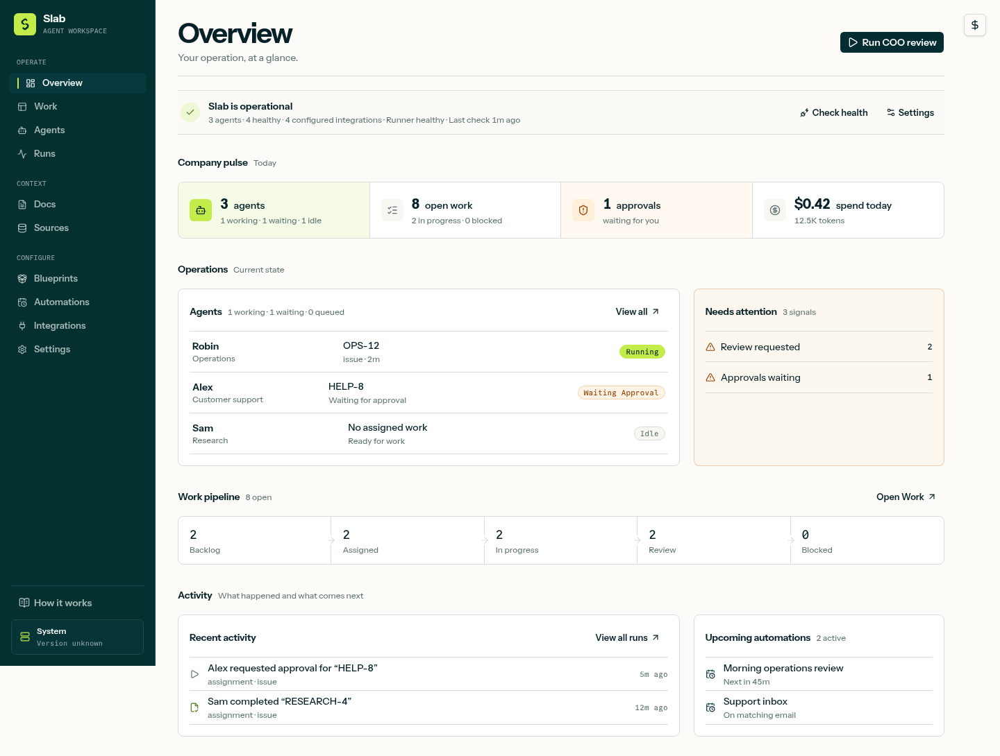
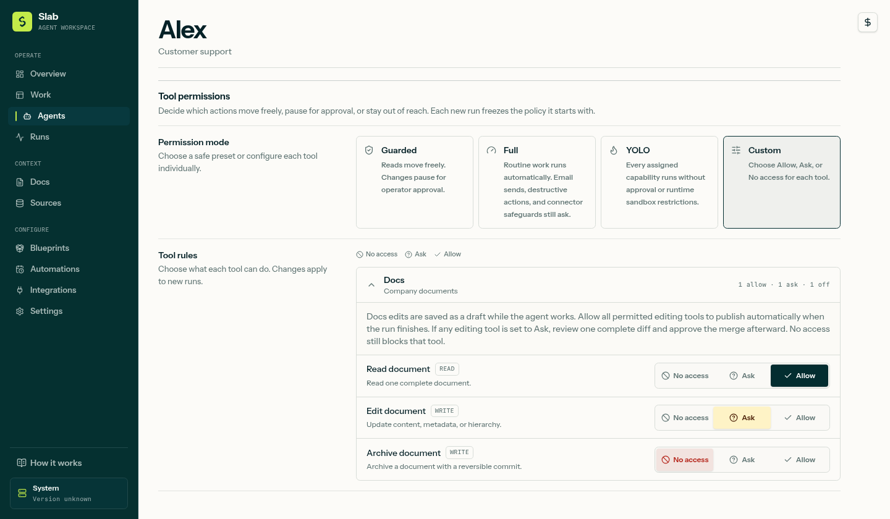
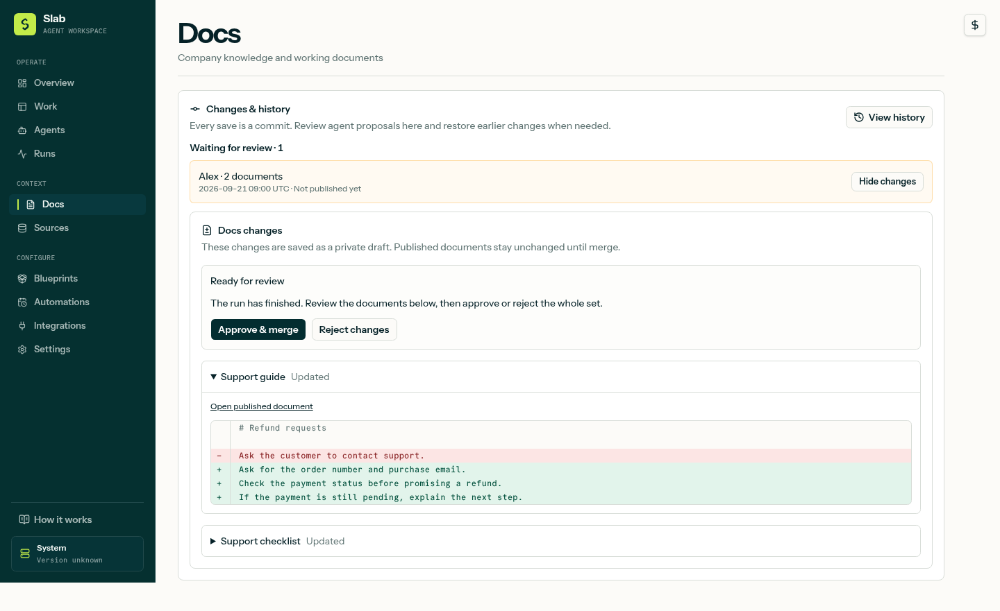

<p align="center">
  
</p>

<h1 align="center">Slab Agents</h1>

<p align="center">
  <strong>A workspace for running your company with AI agents.</strong><br />
  Assign work. Share context. Decide what needs your approval.
</p>

<p align="center">
  <a href="https://github.com/martin2844/slab-agents/actions/workflows/ci.yml"></a>
  <a href="https://github.com/martin2844/slab-stack/releases/latest"></a>
  <a href="LICENSE"></a>
</p>

<p align="center">
  <a href="https://slab.ar">Website</a> ·
  <a href="#install-slab">Install</a> ·
  <a href="#documentation">Documentation</a> ·
  <a href="CONTRIBUTING.md">Contribute</a>
</p>

Slab Agents brings your agents, tasks, company documents, and automations into one workspace. Give each agent a role and access to the tools it needs, then follow its work from the first request to the final result. Open source, hosted on your server, with your choice of supported AI runtime.

[](docs/images/overview.png)

<p align="center"><sub>Real interface, fictional demo workspace. Click any screenshot to see it at full size.</sub></p>

## Install Slab

Run this on your Linux server:

```sh
curl --proto '=https' --tlsv1.2 -fsSL \
  https://github.com/martin2844/slab-stack/releases/latest/download/install.sh \
  | sudo sh
```

The guided installer sets up the services with Docker, lets you choose how to access Slab, and prints your workspace URL. You review the installation plan before it makes changes. No repository checkout or Node.js installation required.

**You'll need:** a supported Linux server with administrator access, at least **4 GB RAM** and **25 GB free disk**, plus access to a supported AI runtime. Ubuntu 24.04 is a supported host. Server and AI costs are paid separately.

[Installation and first steps](docs/getting-started.md) · [Supported hosts](https://github.com/martin2844/slab-stack/blob/v0.1.2/docs/compatibility.md) · [Release notes](https://github.com/martin2844/slab-stack/releases)

<details>
<summary>Inspect the installer before running it</summary>

```sh
curl --proto '=https' --tlsv1.2 -fsSL \
  https://github.com/martin2844/slab-stack/releases/latest/download/install.sh \
  -o install.sh
less install.sh
sudo sh install.sh
```

</details>

> The installer uses the latest stable stack release. This README follows development; available features depend on the version you install. Unreleased previews are labeled below.

## From a task to a workflow

Start small: connect a runtime in **Settings → Runtime**, create an agent, and give it one useful document and one clear task.

> “Read our support guide. Suggest clearer answers for refund requests and point out any missing information.”

Open the conversation to see the result, tool activity, and anything waiting for your approval. Once the task works the way you want, make it an automation.

- **Agents with a defined job.** Set instructions, models, documents, and tool access for support, sales, research, or operations. Blueprints provide starter agents and workflows.
- **Shared work and knowledge.** Assign tasks, track progress and blockers, and give agents company docs or selected external sources.
- **Work that starts itself.** Schedule recurring tasks or respond to incoming email. WhatsApp automation is available in development builds with the integration installed.
- **Connected tools.** Use email, calendars, analytics, WhatsApp, and custom integrations. Access is assigned per agent; connecting an account does not give every agent permission to use it.

## You decide what needs review

Start with **Guarded** permissions, use **Full** for more autonomy, or choose **Custom** to set each tool to **Allow**, **Ask**, or **No access**. Integrations may still require approval for sensitive actions. Permission changes apply to new runs.

<details>
<summary>See individual tool permissions</summary>

[](docs/images/permissions.png)

</details>

<details>
<summary>Development preview: document proposals and version history</summary>

An agent can prepare edits across several documents and leave one proposal for review. Compare the diff, approve the changes together, or reject them. With full editing permission, a successful run publishes its changes as one commit. Published changes can be reverted when they do not conflict with newer edits.

This preview shows ongoing development and is not included in the current stable release. See [permissions and document changes](docs/permissions-and-docs.md) for the workflow.

[](docs/images/docs-review.png)

</details>

## Documentation

| I want to… | Start here |
| --- | --- |
| Install Slab and try my first agent | [Getting started](docs/getting-started.md) |
| Understand permissions and approvals | [Permissions and document changes](docs/permissions-and-docs.md) |
| Automate customer conversations | [Email](docs/email-automations-and-tool-control-plane.md) · [WhatsApp setup](docs/whatsapp.md) · [WhatsApp automations (development)](docs/whatsapp-automations.md) |
| Connect business tools | [Calendars](docs/calendar-integrations.md) · [Google Analytics and Search Console](docs/google-data-integrations.md) · [Custom integrations](docs/custom-integrations.md) |
| Give agents useful context | [Knowledge sources](docs/sources.md) · [Memory](docs/memory.md) · [Blueprints](docs/operator-packs.md) |
| Follow progress and maintain my server | [Notifications](docs/operator-notifications.md) · [Updates, backups, and recovery](https://github.com/martin2844/slab-stack#readme) |
| Work on the code | [Contributing](CONTRIBUTING.md) · [Architecture and configuration](docs/development.md) |

<details>
<summary>Deployment notes</summary>

- Slab is a **single-user workspace**. It does not provide organization roles or separate accounts for teammates.
- Keep your server running for automations. Your browser does not need to stay open.
- Self-hosting keeps the workspace on your server. AI providers and connected services still process the information you send to them.
- WhatsApp uses **WAHA**, an unofficial WhatsApp Web connection. It is not the official WhatsApp Business API and may stop working or put the account at risk. Read the [setup guide](docs/whatsapp.md) before connecting an account.

</details>

## Part of Slab

The installer brings these services together. This repository contains the web workspace and orchestration layer.

| Repository | Responsibility |
| --- | --- |
| **slab-agents** — you are here | Agents, conversations, permissions, automations, and the web interface |
| [slab](https://github.com/martin2844/slab) | Work: projects, tasks, and their MCP tools |
| [slab-docs](https://github.com/martin2844/slab-docs) | Company documents and their MCP tools |
| [slab-runner](https://github.com/martin2844/slab-runner) | Agent execution and AI runtime adapters |
| [slab-stack](https://github.com/martin2844/slab-stack) | Docker deployment, guided installation, and stack releases |

Built with **Next.js, React, TypeScript, and SQLite**, with **MCP** connections to Work, Docs, and integrations. The browser talks to the web app; service credentials stay on the server.

## Contributing

Bug reports, clearer documentation, and focused pull requests are welcome. Start with the [contribution guide](CONTRIBUTING.md) for local setup, validation, and what to include in a PR.

[Report a bug](https://github.com/martin2844/slab-agents/issues/new?template=bug_report.md) · [Suggest an improvement](https://github.com/martin2844/slab-agents/issues/new?template=feature_request.md) · [Report a security issue](SECURITY.md)

## License

[MIT](LICENSE). Copyright © Slab contributors.
