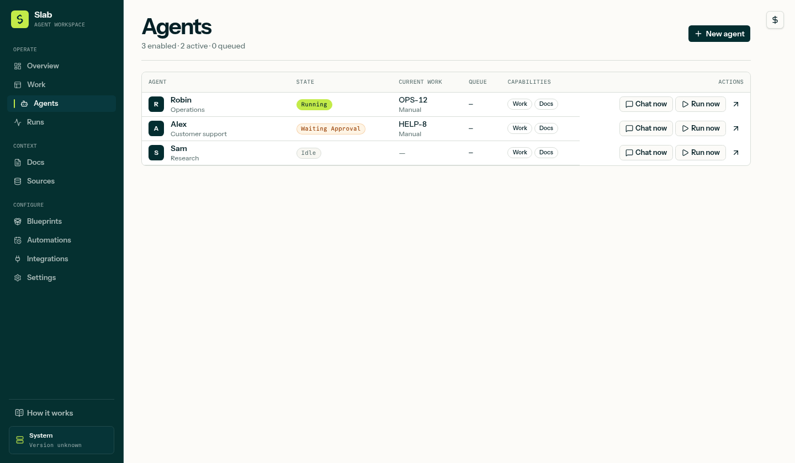

# Get started with Slab Agents

Slab Agents gives you one place to create AI assistants, give them work, and review their results. You host the workspace on your own server and choose the AI services and integrations it uses.

The installer uses the latest stable release. Some features and screenshots in this guide show the current development version. Check the [release notes](https://github.com/martin2844/slab-stack/releases) if a control is missing.

## 1. Install on your server

Use a supported Linux server with administrator access. Ubuntu 24.04 is supported. Plan for at least 4 GB of RAM and 25 GB of free space; additional services may need more. See the [supported host matrix](https://github.com/martin2844/slab-stack/blob/v0.1.2/docs/compatibility.md).

Connect to your server over SSH, then run:

```sh
curl --proto '=https' --tlsv1.2 -fsSL \
  https://github.com/martin2844/slab-stack/releases/latest/download/install.sh \
  | sudo sh
```

The script downloads the signed stable release and starts the setup wizard. Follow its prompts to choose access settings and optional services. Review the plan before confirming. When it finishes, open the URL it prints and sign in with the credentials you set during installation.

Choose domain access if you want to open Slab at your own HTTPS address. If you choose private access, follow the SSH tunnel instructions printed by the installer. Do not expose a private installation by opening its internal service ports.

Docker does not need to be preinstalled on a supported clean host. The installer can install it or reuse a healthy existing installation.

If installation fails, keep the error message and use the [installer troubleshooting guide](https://github.com/martin2844/slab-stack/tree/main/installer#readme). Do not delete the data volumes to retry.

## 2. Check the workspace

Open **Settings** and check the connections for Work, Docs, and Runner. The installer configures these services together; you normally do not need to enter their addresses yourself.

In **Settings → Runtime**, connect an available AI runtime and test it. Follow the sign-in or API-key instructions for that runtime. Available runtimes depend on the installed release.

## 3. Create an agent

Open **Agents → New agent**. Give it a name and a specific role, then write what you want it to do. For example:

> You help maintain our support documentation. Use the company guides to answer questions. If information is missing, say what is missing. Suggest document changes for review.

Choose the runtime and model you connected. Start with **Guarded** permissions. You can also choose a **Blueprint** to create a starter set of agents, instructions, and workflows.



## 4. Give it the right context

Create a document in **Docs**, or connect a knowledge source and assign it to the agent. Add only the integrations the task needs. Connecting an integration and granting an agent access to it are separate steps.

For individual tool rules, open the agent’s **Capabilities** tab and select the **Custom** permission mode. Each tool has an **Allow**, **Ask**, or **No access** setting. Newer builds also offer a **Customize tool rules** shortcut. [See how permissions work](permissions-and-docs.md).

## 5. Try one task

Open the agent’s chat and send a specific request:

> Read our support guide. Suggest clearer answers for refund requests and point out any missing information.

A **run** is one attempt to handle the request. Open it to see the response, tools used, and any approval requests. You can close the browser while it works; the server continues running it.

For document edits, current development builds show a complete proposal in **Docs → Changes & history**. Review the diff and choose **Approve & merge** or **Reject changes**. The agent does not need to stay connected while you decide. This feature may not be in the stable release you installed yet.

## 6. Automate something that already works

Open **Automations** and choose when the workflow should start: a schedule, incoming email, or WhatsApp messages when that integration is available. Choose the agent, give it instructions, and review any sending permissions before activating it.

For WhatsApp, select the audience and reply rules deliberately. A manual reply can pause the agent for that conversation; the chat shows the reason and an **Enable auto replies again** button. See [WhatsApp automations](whatsapp-automations.md).

## Keep it running

The server must stay on for scheduled work and incoming-message automations. Check **Runs** when something fails or needs attention. **System** shows the update tools available to your installation. Use the [Slab Stack guide](https://github.com/martin2844/slab-stack#readme) for backups, updates, and recovery.
