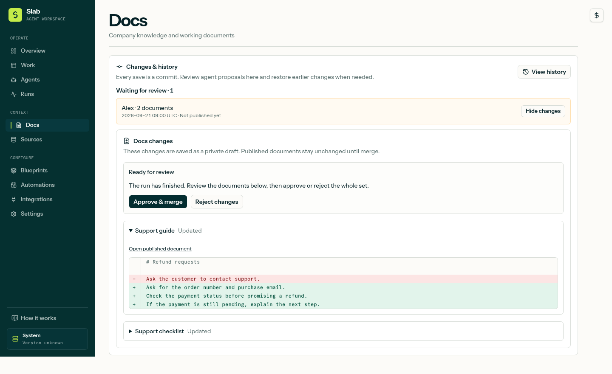

# Permissions and document changes

You choose which tools each agent can use and which actions need your review. Connecting a service does not grant every agent access to it.

## Choose a permission mode

Open an agent’s **Capabilities → Tool permissions**.

| Mode | What to expect |
| --- | --- |
| **Guarded** | Reading is usually automatic. Changes need your approval. Newer builds collect Docs edits into one proposal. |
| **Full** | Routine work runs automatically. Sensitive actions and integration-specific approval rules can still ask. |
| **Custom** | You choose a rule for each tool. Select **Custom** to enable editing; newer builds also have a **Customize tool rules** shortcut. |
| **YOLO** | Removes the usual runtime restrictions and approval requirements for assigned tools. Use only when you intend to grant that level of access; some connector safeguards still apply. |

These settings apply to new runs. Changing them does not change a run that is already queued or in progress.

## What the tool rules mean

- **Allow:** the agent can use the tool without asking each time.
- **Ask:** the action needs your review. In builds with Docs proposals, the agent prepares a draft and asks you to approve the finished set of changes.
- **No access:** the agent cannot use the tool.

If a tool says **Maximum: Ask**, its integration requires approval. An agent-level rule cannot override that requirement. Check the integration’s own settings if you need to change its sending or writing policy.

## Review Docs changes once

The commit and proposal workflow described below is available in the current development version. Check your installed release if these controls are not visible.

When you save a document change, Slab creates a commit with its before-and-after versions. An agent works in a private draft for its run, so it can make several edits without exposing an unfinished document to everyone else.

- If all its permitted Docs editing tools are set to **Allow**, a successful run publishes its edits together as one commit.
- If an editing tool is set to **Ask**, the run finishes and leaves a proposal for you to review.
- If the run fails or is cancelled, its edits remain a draft for review.

Open **Docs → Changes & history** or the run’s **Docs changes** tab. Expand the documents to see what changed, then choose **Approve & merge** or **Reject changes**. A pending review does not keep the agent running.

## Undo a change

In **Changes & history**, select a commit, inspect its diff, and choose **Revert**. You can also ask an agent to inspect the commit and revert it; the agent’s usual permissions still apply.

A revert creates a new commit, so the original remains in history. Slab refuses to overwrite a newer edit. If a proposal or revert conflicts, ask the agent to prepare a new proposal using the current documents.

New commits record content and metadata changes, including title, tags, location, and archive state. Earlier text revisions remain in the document’s revision menu; Slab does not invent commits for changes made before commit tracking was introduced.
